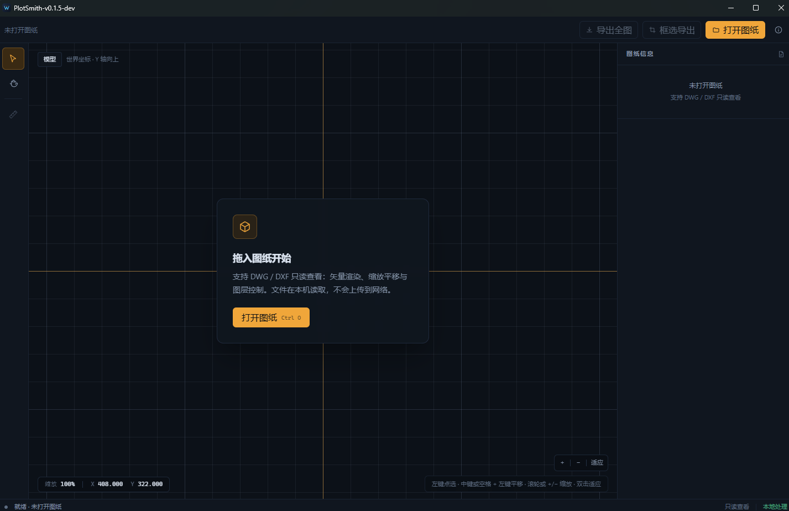

<div align="center">
  
  <h1>PlotSmith</h1>
  <p><strong>免安装的桌面 CAD 图纸查看工具，双击就能用</strong></p>
  <p>
    <a href="#-主要功能"></a>
    <a href="#-系统要求"></a>
    
  </p>

  
</div>

---

打开你手头的 DWG、DXF 图纸，流畅地缩放、平移、查看图层，并一键导出 PNG 图片——不需要安装 AutoCAD 或任何其他 CAD 软件。

## ⬇️ 下载与使用

| 步骤 | 操作 |
| :--- | :--- |
| 1 | 下载便携版 `wilson-plotsmith_v<版本号>_portable.exe` |
| 2 | 双击运行，无需安装、无需管理员权限 |
| 3 | 通过菜单打开图纸，或直接把文件拖进窗口 |

## ✨ 主要功能

- 📐 **打开 DWG / DXF 图纸** —— 内置原生解析器，不依赖外部转换器
- 🚀 **大文件流畅浏览** —— 缩放平移不卡界面
- 🔍 **光标锚点缩放** —— 滚轮缩放以光标为中心，配合“放大 / 缩小 / 适应窗口”按钮
- 🗂️ **图层管理** —— 按图层开关显示，快速聚焦关心的内容
- 🖱️ **图元点选** —— 点击线条、圆、文字等图元查看信息
- 🖼️ **导出 PNG** —— 支持整幅导出，也可框选一块区域只导出需要的部分

## 💻 系统要求

| 平台 | 版本 |
| :--- | :--- |
| Windows | 10 及以上 |

通常已内置所需的 WebView2 组件；若缺失，首次运行会提示安装。普通办公电脑即可流畅查看大尺寸图纸。

## ❓ 常见问题

**文字显示不对？**
部分图纸使用的专用字体（SHX）暂未支持，程序会用系统字体代替，位置正确但字形可能略有差异。

**有些填充图案没显示？**
Hatch 填充、代理实体、外部参照目前只统计数量，尚未渲染，会在信息面板中计数提示。

**为什么不能编辑和保存？**
编辑与保存功能还在开发中，当前版本以“看图”为主。

---

## 🛠️ 开发者指南

PlotSmith 基于 Tauri v2（Rust + WebView2）+ React 19 + TypeScript strict + Tailwind v4 构建，图纸解析使用 acadrust 原生读取。

```bash
npm install                       # 安装依赖（Node ≥ 20.19，Rust ≥ 1.90）
npm run hooks:install             # 启用 pre-commit 版本守卫（首次克隆后执行一次）
npm run dev                       # 桌面端开发
npm run dev:web                   # 仅前端浏览器预览
npm run check                     # TypeScript + 前端 / Rust 全部测试
npm run build:app -- --no-bundle  # 桌面构建（不打包安装器）
npm run deploy                    # 仅 master 分支：构建便携版到 deploy/
```

约定：日常在 `dev` 开发，`master` 只从 `dev` 合入；`dev` 提交前版本号必须大于 `master`，并在 `package.json`、`app/package.json`、`app/src-tauri/tauri.conf.json`、`app/src-tauri/Cargo.toml` 四处保持一致；提交信息使用 Conventional Commits。守卫与发布脚本位于 `scripts/`。

产品规划、架构与模块文档见 [`aiDoc/`](aiDoc/README.md)，性能基准见 [`aiDoc/modules/dxf-render-benchmark.md`](aiDoc/modules/dxf-render-benchmark.md)。
